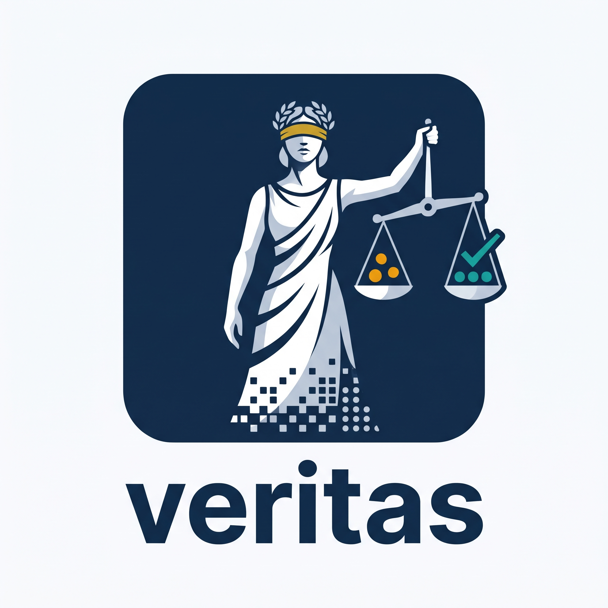
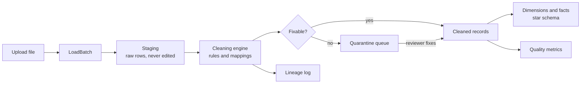

<div align="center">



# Veritas

**Data you can trust.**

A .NET and SQL Server platform that ingests raw, malformed records, repairs them with versioned rules, and publishes an auditable dimensional dataset, without ever destroying the original data.

<!-- Add badges once they exist, for example the CI status:
[](https://github.com/Mthwane/Veritas/actions)
-->


</div>

---

## Overview

Organisations that combine records from several systems end up with duplicates, inconsistent formats, invalid values, and missing fields. Veritas sits between those sources and the people or applications that depend on the data.

It takes raw records into a protected staging layer, cleans them with configurable rules, sends anything it cannot safely fix to a human review queue, and loads the approved result into a star schema ready for analytics.

> **Status:** early development (Sprint 0, project foundation). Features below are the planned scope, not a list of what already works. See the [roadmap](#roadmap).

## Key features (planned)

- **Non-destructive cleaning:** raw rows are stored untouched in staging, and every repair is logged at field level with the rule that made it.
- **Rules as data:** versioned rule sets, cleaning rules, and category mappings managed through the API, so behaviour can change without a redeploy.
- **Cleaning techniques:** windowed deduplication, regex sanitisation, safe type casting, and categorical mapping.
- **Quarantine and review workflow:** records that cannot be repaired automatically are queued for a reviewer to correct, approve, or reject, with optimistic concurrency so two reviewers cannot overwrite each other.
- **Concurrency-safe pipeline:** one load per source at a time, and re-running a batch never creates duplicates.
- **Dimensional output:** a star schema with history tracking (SCD Type 2).
- **Quality reporting:** per-batch metrics such as completeness and duplicate rate.
- **Audit trail:** changes to configuration and review decisions are recorded.
- **Secure access:** JWT authentication with roles, and API keys for programmatic use.
- **Automated delivery:** tests and a CI/CD pipeline.

## How it works



1. A user or API client uploads a file, which creates a **batch**.
2. Every row is stored exactly as received in **staging**.
3. The **cleaning engine** applies the active rule set and records each change.
4. Records that cannot be fixed safely go to **quarantine** for human review.
5. Clean and approved records are merged into the **dimensions** and written to the **fact** table.
6. Quality metrics are calculated for the batch, and changes are written to the audit log.

## Architecture

The solution is split into four projects, with dependencies pointing inwards:

```
Api  ──►  Application  ──►  Domain
  └──►  Infrastructure ──►  Application
```

| Project | Responsibility |
|---|---|
| `Veritas.Api` | HTTP endpoints, request and response contracts, middleware |
| `Veritas.Application` | Use cases, validation, and interfaces the system depends on |
| `Veritas.Domain` | Entities and enums, with no technology dependencies |
| `Veritas.Infrastructure` | EF Core, SQL, file parsing, the pipeline, background jobs, identity |

EF Core handles the CRUD tables. Heavy, set-based cleaning and loading run in SQL, which is far faster than row-by-row processing in C#.

## Tech stack

- **Backend:** C#, ASP.NET Core Web API
- **Database:** SQL Server (Developer edition locally, Express planned for production), EF Core, T-SQL
- **Containers:** Docker and Docker Compose
- **Testing (planned):** xUnit, Testcontainers, tSQLt
- **CI/CD (planned):** GitHub Actions

## Getting started

### Prerequisites

- [.NET SDK](https://dotnet.microsoft.com/download) (the version targeted by the solution)
- [Docker Desktop](https://www.docker.com/products/docker-desktop/)
- Git

### Run with Docker

```powershell
git clone https://github.com/Mthwane/Veritas.git
cd Veritas

# Create your local settings file and set a strong SA_PASSWORD
copy .env.example .env

docker compose up --build -d
docker compose ps
```

The API is published on `http://localhost:5000` and SQL Server on port `1433`.

### Configuration

Secrets are never committed. Settings come from a local `.env` file (used by Docker Compose) and from user secrets when running the API outside Docker.

| Variable | Purpose |
|---|---|
| `SA_PASSWORD` | Password for the SQL Server `sa` account (use a long, strong value without `$`, `;`, `=` or quotes) |
| `MSSQL_PID` | SQL Server edition (`Developer` locally, `Express` for deployment) |

## Project structure

```
Veritas/
├── .github/workflows/     CI/CD pipelines
├── docs/                  vision, architecture, ADRs, sprint notes, API collection
├── src/
│   ├── Veritas.Api/
│   ├── Veritas.Application/
│   ├── Veritas.Domain/
│   └── Veritas.Infrastructure/
├── tests/                 unit, integration, and test data
├── tools/                 data generator and load-test scripts
├── docker-compose.yml
└── Veritas.slnx
```

## Roadmap

Work is planned in two-week sprints, each ending with something demonstrable.

- [ ] **Sprint 0:** repository, solution, Docker, walking skeleton, CI
- [ ] **Sprint 1:** authentication, source systems, file upload, staging load
- [ ] **Sprint 2:** cleaning engine v1 and field-level lineage
- [ ] **Sprint 3:** deduplication, category mappings, quarantine and review
- [ ] **Sprint 4:** dimensional load, SCD Type 2, idempotent re-runs, locking
- [ ] **Sprint 5:** quality metrics, audit log, background orchestration, API polish
- [ ] **Sprint 6:** load testing, hardening, deployment, documentation

Planned later: API keys with rate limiting and quotas, and a thin web front end.

## Documentation

Design documents live in the [`docs/`](docs) folder:

- Vision and scope
- Architecture diagrams and the ER diagram
- Architecture decision records (ADRs)
- Sprint notes and retrospectives

## Testing

Planned approach: unit tests for rule logic, integration tests against a real SQL Server in a container, SQL tests for the cleaning procedures, and concurrency tests that fire parallel requests to prove there are no duplicates or lost updates.

## License

A license has not been chosen yet.

## Author

Built as a final-year computer science project by [@Mthwane](https://github.com/Mthwane).
